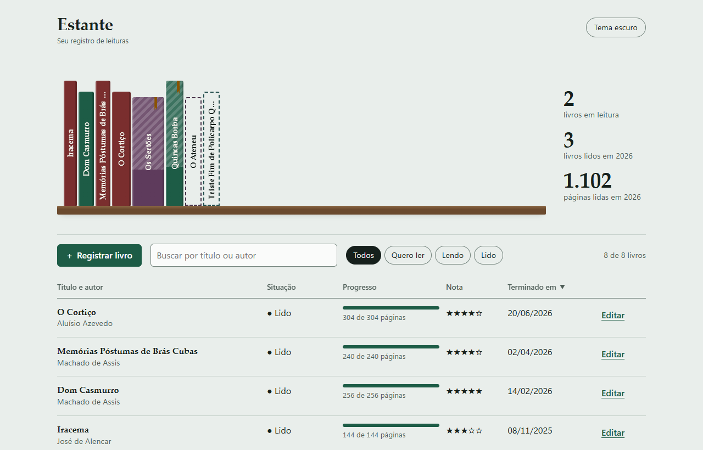
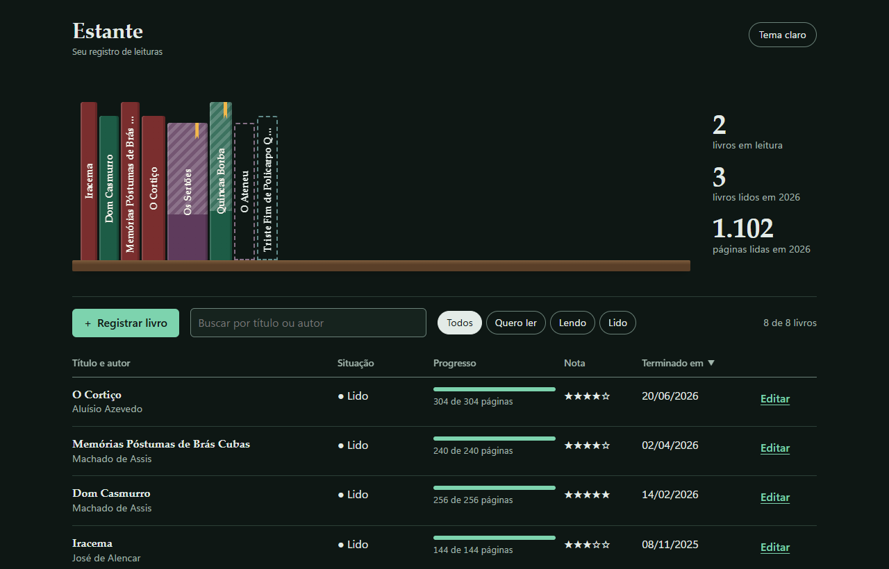

# Estante

Um registro pessoal de leituras. Cada livro vira uma lombada na prateleira: a largura vem do número de páginas e o trecho já lido aparece preenchido. Logo abaixo, uma lista para buscar, filtrar e editar.



<details>
<summary>Tema escuro</summary>



</details>

## Como usar

1. Abra **https://b4sileus-py.github.io/Praticando/estante/**, ou baixe a pasta e abra o `index.html` no navegador. Baixando, não precisa instalar nada nem estar conectado à internet.
2. Clique em **Registrar livro**, ou em **Ver com exemplos** para ver a estante preenchida.
3. Clique numa lombada ou em **Editar** para atualizar a página em que parou.

### Como ler a estante

| Na prateleira | Situação |
|---|---|
| Lombada cheia | Lido |
| Parte cheia, parte listrada, com fita marcadora | Lendo (a parte cheia é o que já foi lido) |
| Contorno tracejado | Quero ler |

## O que dá para fazer

- Registrar livros com título, autor, total de páginas, página em que parou, data de término e nota.
- Buscar por título ou autor, filtrar por situação e ordenar a lista pelos cabeçalhos.
- Ver quantos livros estão em leitura, quantos foram lidos no ano e quantas páginas foram lidas.
- Alternar entre os temas claro e escuro. O tema inicial segue o do sistema.
- Baixar uma cópia dos livros em JSON e abrir essa cópia em outro navegador.

## Decisões de usabilidade

- **Só o título é obrigatório.** O que falta (autor, páginas, nota) aparece em âmbar com ⚠ e não impede de salvar. Antes de salvar, uma confirmação lista o que está faltando.
- **Pendência não é erro.** Vermelho só aparece para erros de verdade, como a página em que parou passar do total.
- **Prevenção de erro.** Campos que não se aplicam à situação ficam desabilitados e dizem por quê. A nota, por exemplo, só é liberada quando o livro está como "Lido".
- **Confirmação só quando há risco.** Excluir, descartar alterações e trocar a estante por uma cópia pedem confirmação, e o foco começa no lado seguro.
- **Teclado.** Enter avança para o próximo campo, as setas movem entre as opções de cada grupo e o foco está sempre visível.
- **Plano B.** Se o download da cópia falhar, a tela mostra os dados para copiar à mão.

## Acessibilidade

- Contraste WCAG AA em todas as cores, nos dois temas.
- Cada lombada é um botão com descrição para leitor de tela (título, autor, situação e porcentagem lida).
- Funciona em telas a partir de 360px; no celular, a tabela vira uma lista.
- Respeita a preferência do sistema por menos movimento.

## Onde ficam os dados

Os livros ficam guardados **só no navegador em que foram cadastrados** (localStorage). Limpar os dados do navegador apaga a estante, por isso existe o botão **Baixar cópia**. Nada é enviado para a internet.

## Tecnologia

Um único arquivo HTML, com CSS e JavaScript puros, sem bibliotecas e sem conexões externas. As fontes são as do sistema (Palatino Linotype e Segoe UI no Windows).

## Testes

Os testes de comportamento usam o Playwright com o Microsoft Edge já instalado no computador:

```bash
cd estante/testes
npm i playwright-core
node teste.mjs ./capturas
```

São 31 verificações: tela vazia, exemplos, filtros com teclado, busca, ordenação, erros e pendências do formulário, confirmações, persistência depois de recarregar, exclusão, troca de tema e ausência de rolagem horizontal a 380px.

Ainda não foram testados o Firefox, o Safari e um leitor de tela de verdade.

## Versão

**0.1**: primeira versão.

Direção visual e o que foi descartado: [design-notes.md](design-notes.md).

---

Desenvolvido por Roberto
